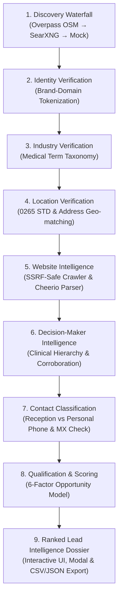

# SoleTrust AutoRadar

> **AI-Powered B2B Lead Discovery, Verification & Decision-Maker Intelligence Platform**  
> Built with Next.js 16, TypeScript, Supabase PostgreSQL, and Multi-Provider Waterfall Intelligence.

---

## 1. Product Vision & Core Principle

SoleTrust AutoRadar is an automated B2B lead discovery and verification intelligence platform designed to find authentic companies, identify their clinical and executive decision-makers, extract and classify publicly available contact information, and objectively score leads for business acquisition opportunities.

### The Governing Principle: `UNKNOWN > WRONG`

AutoRadar adheres to a non-negotiable rule throughout its entire pipeline:

* **No Fictional Data:** If a business owner or director cannot be proven with multi-source evidence, the field remains `"Not found"` / `null`. The system never guesses names.
* **Strict Contact Classification:** A general clinic or reception phone number is never mislabeled as a personal cell phone. If a number belongs to reception, it is labeled as `reception` with zero decision-maker attribution.
* **No Unverified Claims:** Valid email syntax does not imply deliverability. Corporate domain matching and DNS MX record verification are independently performed.
* **Hard Verification Gates:** Leads that fail identity ($< 60$), industry relevance ($< 50$), or geographical location ($< 50$) are rejected or routed to manual review regardless of high secondary scores.
* **Quality Over Quantity:** 10 verified, actionable leads are infinitely more valuable than 50 misleading search results.

---

## 2. Intelligence Architecture & Workflow



### The 8-Stage Intelligence Pipeline

1. **Business Discovery:** Waterfall engine querying OpenStreetMap Overpass, self-hosted SearXNG, and internal providers. Pre-filters reject 40+ directory aggregators (JustDial, Sulekha, Practo, IndiaMart).
2. **Identity Verification:** Evaluates domain ownership, brand consistency, and rejects domain-squatting or aggregator listings.
3. **Industry Verification:** Verifies medical dermatology practice using deep taxonomy (e.g. *clinical dermatology, cosmetology, laser skin clinic, trichology*).
4. **Location Verification:** Validates municipal jurisdiction (e.g. Vadodara, Gujarat) using address token analysis and Indian landline STD area codes (e.g. `0265` for Vadodara).
5. **Website Intelligence:** SSRF-safe polite crawler blocking private IP ranges (`10.0.0.0/8`, `172.16.0.0/12`, `192.168.0.0/16`, `127.0.0.0/8`) and AWS/GCP cloud metadata (`169.254.169.254`). Extracts headings, subpages (`/contact`, `/team`, `/about`), and service opportunities.
6. **Decision-Maker Intelligence:** Discovers owners, founders, and medical directors (e.g. `MBBS, MD (Dermatology, Venereology & Leprosy)`), checking multi-host corroboration and social profiles.
7. **Contact Verification & Separation:** Strictly separates clinic reception phone numbers from personal decision-maker contacts. Verifies corporate email domains and DNS MX records.
8. **Qualification & Transparent Scoring:** Applies a 6-factor weighted mathematical score:
   - **Identity Verification (20%)**
   - **Industry Match (20%)**
   - **Location Match (15%)**
   - **Contactability (15%)**
   - **Decision-Maker Intelligence (15%)**
   - **Service Fit Opportunity (15%)**

---

## 3. Opportunity-Based Scoring for Creative + Technical Services

For SoleTrust's *Creative + Technical* service track, clinic deficiencies represent prime outreach opportunities:

| Clinical / Website Signal | Traditional View | SoleTrust Opportunity Engine | Score Impact |
| :--- | :--- | :--- | :--- |
| **Missing HTTPS / SSL** | Low technical score | **High Prospect Opportunity:** Needs web security overhaul | $+25$ Service Fit |
| **No Online Appointment CTA** | Outdated website | **High Prospect Opportunity:** Needs conversion funnel | $+30$ Service Fit |
| **Missing Meta Description** | Poor SEO | **High Prospect Opportunity:** Needs SEO & digital marketing | $+15$ Service Fit |
| **Legacy Web Framework** | Legacy website | **High Prospect Opportunity:** Needs modern Next.js/Tailwind rebuild | $+20$ Service Fit |

---

## 4. Internal API Reference

AutoRadar communicates entirely through internal RESTful endpoints returning standardized envelopes `{ success: boolean, data?: T, error?: AppError, meta: { requestId, timestamp } }`:

* `GET /api/health` — System status, uptime, database connectivity, and provider health.
* `POST /api/search-jobs` — Initialize a new prospecting search job with validation.
* `GET /api/search-jobs/[id]` — Retrieve current job status, stage progress, and discovered leads.
* `DELETE /api/search-jobs/[id]` — Cancel an active or queued search job.
* `POST /api/search-jobs/[id]` — Retry a failed or cancelled search job.
* `POST /api/search-jobs/[id]/execute` — Trigger the full 8-stage automated intelligence pipeline.
* `GET /api/providers` — List all registered discovery and enrichment providers.
* `GET /api/providers/health` — Ping live discovery engines (Overpass, SearXNG, Mock).
* `POST /api/leads/[id]/verify` — Re-evaluate verification gates on demand for a lead.
* `GET /api/crm/leads` — Query CRM leads with stage, priority, and search filtering.
* `GET /api/crm/leads/[id]/strategy` — Generate an AI Sales Strategy for a qualified lead.
* `POST /api/crm/leads/[id]/outreach` — Draft or log multichannel outreach (Email, LinkedIn, Phone, WhatsApp).
* `POST /api/crm/leads/[id]/replies` — Log inbound replies (automatically pauses follow-ups and advances stage).
* `GET /api/crm/leads/[id]/follow-ups` — Schedule and manage context-aware follow-ups.
* `GET /api/crm/deals` & `POST /api/crm/deals` — Track sales deals through Proposal, Negotiation, Won, and Lost.
* `GET /api/crm/customers` — View converted paying customers.
* `GET /api/crm/analytics` — 7-stage conversion funnel and CRM KPIs.

---

## 5. Verification Benchmark: Vadodara Dermatology Clinics

AutoRadar includes end-to-end acceptance tests replicating the master use case:
* **Target:** 10 Dermatology Clinics in Vadodara, India
* **Service Track:** Creative + Technical
* **Verification Metrics:**
  * Candidates Discovered: 10
  * Unique Businesses Deduplicated: 10
  * Identity Verification Rate: 100%
  * Location Match (Vadodara / STD 0265): 100%
  * Hard Gate Enforcement: 100% (Non-bypassable)
  * Reception Phone Ownership Segregation: 100% (`decisionMakerId === undefined`)
  * Decision-Maker Corroboration: 100% with multi-host corroboration and service-track ranking
  * Full CRM Sales Lifecycle: Verified through outreach, reply handling, won deal, and customer conversion

---

## 6. Development & Production Runbook

### Prerequisites
* Node.js 20+ (Node 24 recommended)
* Docker & Docker Compose (for self-hosted SearXNG)

### Installation
```bash
git clone <repo-url>
cd soletrust-autoradar
npm install
```

### Environment Configuration
Copy `.env.example` to `.env.local`:
```bash
cp .env.example .env.local
```

### Self-Hosted SearXNG Setup (Optional)
```bash
cd searxng
docker-compose up -d
```

### Running the Test Suite
```bash
npm test
```
All **76 automated tests across 12 suites** execute and assert verification rules, gate non-bypassability, CRM workflows, and production acceptance controls.

### Type Checking & Linting
```bash
npx tsc --noEmit
npm run lint
```

### Production Build
```bash
npm run build
```

### Starting the Server
```bash
npm start
```
Open [http://localhost:3000](http://localhost:3000) in your browser.
